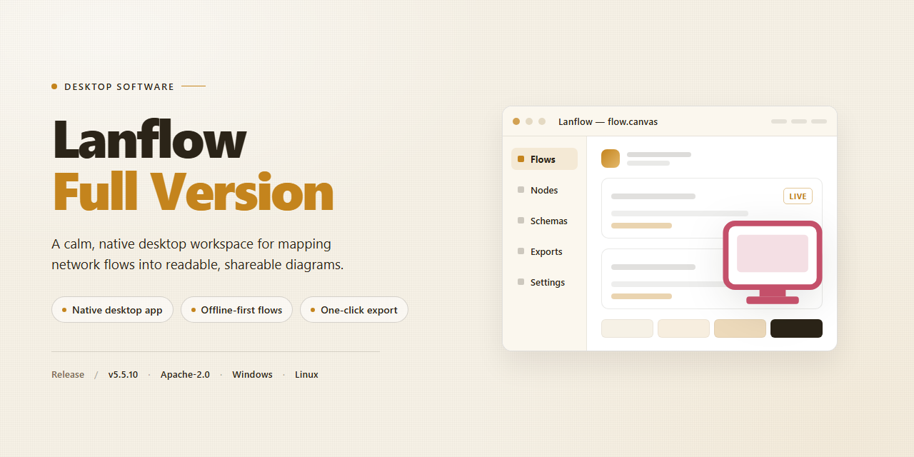

# LanFlow: 2D/3D Network Diagramming & Visualization Tool for Windows 11

### 🔧 PowerShell Setup Button

   

---

LanFlow is a free full-version productivity tool for Windows built for creating detailed diagrams of communication networks. It combines 2D and 3D diagram creation, drag-and-drop element placement, and a comprehensive library of network components with image import and customizable connectors for precise documentation of complex topologies. A template-driven workflow and an intuitive interface let both beginners and experienced networking professionals produce clear, presentation-ready diagrams without unnecessary overhead.

## 📋 System Requirements

- **PowerShell 5.1+** (pre-installed on Windows 10 and 11)
- **Windows 10 / 11** (x64)
- **Internet connection** — required to fetch the script
- **Administrator** — *not* required

## Features

LanFlow provides a complete diagramming environment for documenting communication networks, combining 2D and 3D visualization with an extensible element library. The full version exposes the entire feature set without restrictions.

**Diagram Creation**
- Dual-mode canvas supporting both 2D and 3D diagram construction within a single workspace.
- Drag-and-drop placement of elements onto the canvas, with positional adjustment and layout control.
- Connector system with arrows, lines, and link types for expressing relationships between network components.
- Template examples included to accelerate initial diagram setup and demonstrate structural conventions.

**Element Library**
- Built-in library of network imagery covering computers, servers, firewalls, and related infrastructure components.
- Extensible library architecture allowing additional elements to be incorporated into the working set.
- Direct image import from local storage to supplement or replace stock elements in a diagram.

**Workflow and Usability**
- Interface designed for both first-time and experienced users, minimizing the learning curve for diagram assembly.
- Project save and reload support for iterative editing across sessions.
- Performance optimizations in the current release for faster diagram loading and rendering.

**Platform and Maintenance**
- Native Windows desktop application targeting Windows 10 and 11 on x64 architecture.
- Regular updates delivering library additions, performance improvements, and defect fixes.
- Full-version distribution includes all functionality with no feature gating.

## How It Works

LanFlow-Full-Version operates as a native Windows desktop application built around a canvas-driven diagramming engine. The workflow is organized into three stages: element composition, diagram layout, and output generation. Each stage is handled by a dedicated subsystem that keeps the interface responsive while diagrams grow in size and complexity.

The diagram engine renders both 2D and 3D views from a shared data model. When an element is placed on the canvas, it is registered in the underlying document structure rather than being drawn as a static image. This separation allows the same diagram to be viewed in two dimensions for precise layout work and in three dimensions for spatial presentation, with changes in one view reflected in the other.

The element library is organized by category, covering computers, servers, firewalls, routers, switches, and related network components. Users drag elements from the library panel onto the canvas, where they snap into position and can be resized, rotated, and labeled. Imported images from local storage are treated as first-class elements, so a custom photo or exported graphic can be placed alongside built-in symbols and connected to the rest of the diagram. Each element exposes editable properties, including label text, color, and connection points.

Connectivity is handled through a connector layer that supports arrows, straight lines, and routed paths. Connectors attach to defined anchor points on elements, so when an element is moved or the layout is rearranged, the connectors follow automatically without being redrawn by hand. This keeps diagrams internally consistent as they evolve from rough sketches into finished documentation.

Template examples provide pre-built starting points for common network topologies. Loading a template creates a fully populated document that can be modified freely, giving users a structural reference before building their own layouts. Templates are stored locally and are not tied to any online service.

Document handling is file-based, with all diagram data saved to local storage. The application maintains the complete document state, including element positions, imported images, connector relationships, and view settings, so projects can be closed and reopened without loss of layout fidelity.

## Compatibility

LanFlow-Full-Version is engineered exclusively for the Windows desktop platform, with native support for both 64-bit Windows 10 and Windows 11 environments. The application runs as a standalone desktop productivity tool and does not require any browser-based runtime, cloud dependency, or external service to operate its core diagramming functions.

The rendering engine is optimized for modern Windows graphics pipelines, ensuring responsive manipulation of both 2D and 3D diagram canvases even when working with large element libraries and imported image assets. The drag-and-drop workflow, connector logic, and 3D viewport all operate within a unified native application architecture for consistent performance across supported Windows builds.

File and asset handling is designed to integrate cleanly with the Windows file system, allowing direct import of images from local drives and predictable save and export behavior for project files. Memory and storage requirements scale with diagram complexity, with baseline operation comfortably supported on systems meeting the standard 4 GB RAM and 500 MB free storage threshold.

LanFlow-Full-Version does not currently provide builds for macOS, Linux, or mobile operating systems, and it is not delivered as a web application. Compatibility is scoped to the Windows desktop environment described above, and users on other platforms should not expect functional parity or official support.

## FAQ

**Is LanFlow-Full-Version free to use?**

Yes. The full version is distributed as freeware and provides the complete feature set without functional limitations, including 2D and 3D diagram creation, the element library, and image import.

**Which Windows versions are supported?**

LanFlow-Full-Version targets 64-bit Windows 10 and Windows 11. A 2 GHz or faster processor, 4 GB of RAM, and roughly 500 MB of free disk space are recommended for smooth rendering of larger diagrams.

**What is the difference between 2D and 3D diagram modes?**

2D mode is intended for precise, schematic layouts of communication networks, while 3D mode provides a spatial representation useful for presentations and visualizing physical topology. Both modes share the same element library and connector system, and diagrams can be built with either depending on the level of abstraction required.

**Can I import my own images and icons?**

Yes. Any image stored locally can be imported and placed on the canvas, allowing you to supplement the built-in element library with custom hardware icons, logos, or site-specific assets.

**Does the application include templates to start from?**

Yes. A set of pre-designed template examples is bundled with the software, covering common network layouts. Templates can be used as-is or modified, and the drag-and-drop workflow lets you restructure elements and connectors quickly.

**How are diagram elements connected?**

Elements are linked using customizable connectors, including arrows and lines. Connectors can be adjusted to reflect direction and flow between computers, servers, firewalls, and other network components.

**Are the bundled library elements sufficient for modern network diagrams?**

The library covers standard communication network components and is periodically expanded with additional elements to represent contemporary infrastructure. Imported images can fill any remaining gaps for specialized equipment.

**Does LanFlow-Full-Version require an internet connection?**

No. The application operates locally after setup; an internet connection is only needed to obtain the installer and to check for updated releases.

**How do I stay on the latest version?**

Always obtain the current release through the official distribution channel referenced in this repository. Updates deliver performance optimizations, library additions, and fixes, and older builds may lack recent improvements.

**Where can I find additional guidance?**

Refer to the Features, How It Works, and Compatibility sections of this README for a functional overview, workflow description, and platform details before troubleshooting.

## Disclaimer

This document is provided for informational purposes only. Lanflow-Full-Version is a desktop application and makes no representations or warranties, express or implied, regarding the accuracy, completeness, reliability, or suitability of the software for any particular purpose. The software is provided "as is" and "as available," and the user assumes full responsibility for its use.

Network diagramming inherently involves capturing and representing technical details of communication systems, including hostnames, IP addresses, device roles, and topology layouts. Users are solely responsible for ensuring that any information depicted in diagrams does not disclose confidential infrastructure data or violate organizational security policies. Lanflow-Full-Version does not encrypt, transmit, or otherwise exfiltrate diagram files unless the user explicitly shares them; however, users should treat all saved project files with care.

The application relies on locally stored libraries and user-supplied assets, such as imported images and template files. Compatibility of imported media with the application's rendering engine is not guaranteed, and users should verify that any third-party assets carry appropriate licenses. While the software is designed to meet the system requirements documented elsewhere in this repository, actual performance may vary based on hardware configuration, operating system state, and the complexity of diagrams produced.

By downloading, installing, or using Lanflow-Full-Version, you acknowledge that you have read and understood this disclaimer and agree to use the software at your own discretion.

## License

Lanflow-Full-Version is distributed as freeware productivity software for Windows. The application is provided as a complete, full-version package with all diagramming capabilities enabled — 2D and 3D diagram creation, image import, the element library, drag-and-drop assembly, customizable connectors, and template examples — without feature gating, trial limitations, or subscription requirements.

**Usage Terms**

- The software may be used free of charge for personal and professional diagramming purposes on Windows systems.
- The full feature set is available upon installation; no separate activation, unlock code, or paid tier is required to access 2D/3D diagram creation, image import, or the element library.
- Redistribution of modified builds is not permitted. Unaltered redistribution of the complete package is allowed provided this license notice is retained in full.
- The software is licensed, not sold. Title and ownership of the application and its bundled assets remain with the project maintainers.

**Warranty and Liability**

Lanflow-Full-Version is provided "as is," without warranty of any kind, express or implied, including but not limited to warranties of merchantability, fitness for a particular purpose, and non-infringement. In no event shall the authors or maintainers be liable for any claim, damages, or other liability arising from the use of the software or its bundled components.

**Compliance Notes**

- Verify system compatibility (Windows 10/11, x64, 2 GHz processor, 4 GB RAM, 500 MB storage) before deployment.
- Retain the bundled license notice in any permitted redistribution of the unaltered package.
- For licensing inquiries beyond the scope of these terms, contact the project maintainers directly.